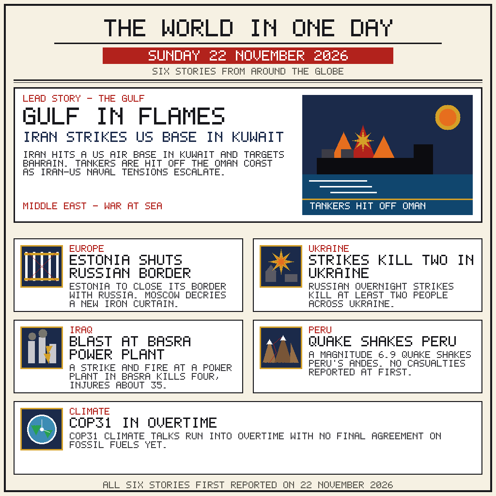

# The World in One Day — Sunday 22 November 2026

[](https://make.fun/bounty/news-image-20261122?utm_source=github&utm_medium=readme&utm_campaign=news-image-20261122)
[](https://make.fun/bounty/news-image-20261122/leaderboard?utm_source=github&utm_medium=readme&utm_campaign=news-image-20261122)
[](https://make.fun/bounty/news-image-20261122?utm_source=github&utm_medium=readme&utm_campaign=news-image-20261122)
[](https://opensource.org/licenses/MIT)
[](https://nodejs.org/)

A newspaper front page that sums up the world's news of **Sunday 22 November 2026** in a single 1024×1024 image, drawn entirely in code by `main.ts` (Node 22, standard library only). Entry for the [make.fun](https://make.fun) competition `news-image-20261122`.



## The six stories

1. **GULF IN FLAMES** (lead) — Iran strikes a US air base in Kuwait and targets Bahrain; tankers are hit off the Oman coast as Iran–US naval tensions escalate.
2. **ESTONIA SHUTS RUSSIAN BORDER** — Estonia to close its border with Russia; Moscow decries a "new Iron Curtain".
3. **STRIKES KILL TWO IN UKRAINE** — Russian overnight strikes kill at least two people across Ukraine.
4. **BLAST AT BASRA POWER PLANT** — A strike/fire at an electricity plant in Basra, Iraq kills four and injures about 35.
5. **QUAKE SHAKES PERU** — A magnitude 6.9 earthquake shakes Peru's Andes; no casualties immediately reported.
6. **COP31 IN OVERTIME** — COP31 climate talks run into overtime with no final agreement on fossil fuels yet.

## How it works

`main.ts` draws the whole front page from scratch — no image assets, no network, no dependencies:

- its own PNG encoder (raw RGB scanlines, `node:zlib` deflate, CRC32 chunk checksums),
- its own 5×7 bitmap font (uppercase, digits, punctuation) with word wrapping,
- its own geometric icons: a burning tanker at sea for the lead, a barred border gate, a night blast, a power plant with lightning, cracked Andes peaks, and a globe-clock for COP31.

The output is fully deterministic: no clock, no randomness, fixed compression, so every run produces byte-identical PNG bytes.

## How to run

```sh
mkdir -p out && MAKEFUN_OUTPUT_DIR=out node main.ts
```

This writes `out/entry.png` — a PNG, exactly 1024×1024, well under the 1 MiB limit. Run it twice and compare `sha256sum`: the hashes match.

## License

MIT — see [LICENSE](LICENSE).
